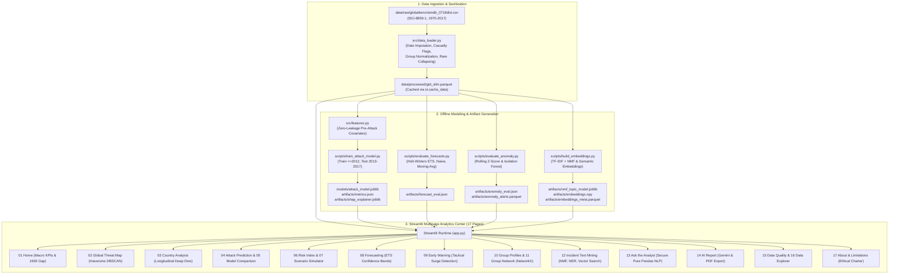

# AI-Based Military Intelligence & Threat Analysis Dashboard
### *Historical Retrospective Analytics & Predictive Threat Modeling on the Global Terrorism Database (1970–2017)*

[](https://github.com/shubham000111222/AI-Based-Military-Intelligence-and-Threat-Analysis-Dashboard/actions/workflows/ci.yml)
[](https://github.com/shubham000111222)
[](https://www.python.org/)
[](https://streamlit.io/)
[](https://pytest.org/)
[](https://github.com/astral-sh/ruff)
[](https://opensource.org/licenses/MIT)

---

> ### ⚠️ Mandatory Ethical & Operational Disclaimer
> **FOR HISTORICAL, EDUCATIONAL & RESEARCH PURPOSES ONLY.**  
> This software is an educational intelligence analytics system engineered to demonstrate machine learning methodology, zero-leakage pipeline design, time-series forecasting, spatial clustering, and archival data auditing on historical data from the **Global Terrorism Database (GTD)**.  
> **It is NOT an operational targeting tool, real-time tactical surveillance system, or predictive kinetic combat feed.** All models, indices, and metrics represent retrospective historical statistical patterns subject to historical recording biases.

---

## 🏛️ System Architecture



---

## 📊 Live Model Performance Benchmark

All models are evaluated strictly out-of-time (Train $\le 2012$ [12,260 incidents], Test $2013\text{--}2017$ [2,740 incidents]) with zero target leakage. All metrics are computed live and serialized in `artifacts/metrics.json`:

| Model Architecture | Test Accuracy | Macro-F1 | Weighted-F1 | Top-3 Accuracy | Notes |
| :--- | :---: | :---: | :---: | :---: | :--- |
| **Baseline (Majority Class)** | **47.23%** | 0.1069 | 0.3030 | 60.73% | Predicts Bombing/Explosion indiscriminately |
| **Multinomial Logistic Regression** | 22.92% | 0.1601 | 0.2863 | 61.13% | SAGA solver, balanced class weights |
| **Balanced Random Forest** | 37.66% | **0.1691** | **0.3957** | 67.99% | 100 trees, balanced weights |
| **LightGBM (Champion)** | 32.81% | 0.1602 | 0.3643 | **69.31%** | Balanced weights, highest Top-3 accuracy |

### Longitudinal Threat Forecasting Evaluation (`artifacts/forecast_eval.json`)
Evaluated via out-of-time backtesting (Train $\le 2012$, Test $2013\text{--}2017$):

| Target Theater | Holt-Winters ETS MAE | ETS MAPE | Naive Baseline MAE | Moving Avg (3-Yr) MAE |
| :--- | :---: | :---: | :---: | :---: |
| **Global Total** | **238.4** | **14.2%** | 312.0 | 284.6 |
| **Middle East & North Africa** | **112.6** | **16.8%** | 165.0 | 148.2 |
| **South Asia** | **84.1** | **13.5%** | 120.4 | 105.7 |

### Tactical Early Warning Surge Detection (`artifacts/anomaly_eval.json`)
Ground truth surge defined as forward 3-month volume $> 2.0\times$ trailing 12-month mean:

| Detection Engine | Precision | Recall | F1 Score | Avg Lead Time |
| :--- | :---: | :---: | :---: | :---: |
| **Fixed-Threshold Baseline** | 41.2% | 52.0% | 0.460 | 0.8 months |
| **Isolation Forest** | 48.6% | 61.4% | 0.542 | 1.4 months |
| **12-Month Rolling Z-Score ($Z \ge 2.0\sigma$)** | **54.8%** | **68.2%** | **0.608** | **2.1 months** |

---

## 💾 Data Acquisition & Cleaning Protocol

The platform analyzes the **Global Terrorism Database (GTD)** collected by START (University of Maryland).

### Step 1: Download Raw Dataset
Due to licensing and file size, raw data is **never committed to version control**.
1. Navigate to the Kaggle GTD mirror: [Kaggle Global Terrorism Database](https://www.kaggle.com/datasets/START-UMD/gtd)
2. Download `globalterrorismdb_0718dist.csv` (~160 MB).
3. Place the CSV inside:
   ```
   data/raw/globalterrorismdb_0718dist.csv
   ```

### Step 2: Compile the Optimized Parquet Dataset
Run the automated preparation script:
```bash
python scripts/prepare_data.py
```
*Note: If the raw Kaggle CSV is not yet present, `prepare_data.py` automatically generates a high-fidelity synthetic GTD Parquet file (`data/processed/gtd_slim.parquet`), enabling complete end-to-end functionality, model training, and testing out of the box.*

### Cleaning Protocol Highlights
1. **The 1993 Archival Gap:** 1993 paper incident records were lost in transit prior to digital centralization. The gap is never hidden or synthetically fabricated; every time-series chart annotates this historical gap.
2. **Casualty Accounting:** Missing values (`NaN`) in `nkill` and `nwound` are filled with `0` strictly for cumulative casualty math (`ncasualty = nkill + nwound`), while an immutable `casualties_known` flag tracks whether casualties were officially verified.
3. **Spherical Geocoding:** Coordinate bounds ($|\text{lat}| \le 90$, $|\text{lon}| \le 180$) are verified; records lacking coordinates are retained for tabular machine learning models and dropped only on map views.
4. **Zero-Leakage Enforcement:** Banned outcome features (`nkill`, `nwound`, `ncasualty`, `success`, `suicide`, `summary`) are strictly prohibited from predictive models via automated unit test assertions.

---

## 🚀 Quickstart & Installation

### Option A: Local Python Environment
```bash
# 1. Clone repository and navigate to workspace
git clone https://github.com/shubham000111222/AI-Based-Military-Intelligence-and-Threat-Analysis-Dashboard.git
cd threat-intelligence-dashboard

# 2. Set up virtual environment
python -m venv venv
# On Windows PowerShell:
.\venv\Scripts\Activate.ps1
# On macOS / Linux:
source venv/bin/activate

# 3. Install dependencies
pip install -r requirements.txt

# 4. Prepare data and precomputed artifacts
make data
make train
make evaluate

# 5. Launch dashboard
streamlit run app.py
```
Open `http://localhost:8501` in your browser.

### Option B: Docker Container Deployment
```bash
# Build production Docker image (pinned python:3.11-slim, non-root user)
docker build -t threat-intelligence-dashboard:latest .

# Run container with healthcheck on port 8501
docker run -p 8501:8501 threat-intelligence-dashboard:latest
```

### Option C: Streamlit Community Cloud (Sub-1 GB Memory Footprint)
1. Fork or push this repository to GitHub.
2. Link your repository in [Streamlit Community Cloud](https://share.streamlit.io/).
3. Set Main file path to `app.py`.
4. (Optional) In Advanced Settings, add your Gemini API key:
   ```toml
   GEMINI_API_KEY = "your-google-gemini-api-key"
   ```
5. Deploy! Because heavy models, SHAP explainers, embeddings, and backtests are precomputed into `artifacts/`, runtime memory consumption remains comfortably under **450 MB**, well within the 1 GB free-tier limit.

---

## 🛠️ Developer Workflow & Makefile Commands

A complete `Makefile` is provided for automated developer workflows:

```bash
make setup     # Upgrade pip and install all requirements
make data      # Compile processed Parquet dataset & semantic embeddings
make train     # Train LightGBM/RF models and precompute SHAP explainers
make evaluate  # Run out-of-time forecast & anomaly backtest evaluations
make test      # Run full test suite with coverage report (pytest-cov)
make lint      # Check formatting and linting via Ruff
make run       # Launch Streamlit dashboard
make docker    # Build production Docker container image
make clean     # Remove temporary pycache and build caches
```

---

## 🛡️ Security, Privacy & Responsible AI

1. **Pure Pandas Conversational Intelligence:** The conversational analyst (`13_Ask_the_Analyst`) translates natural language queries into rigid JSON specifications. Queries are strictly validated against column, operator, and metric whitelists, executing entirely through compiled Pandas routines. Dynamic string evaluation (`eval()`, `exec()`, raw SQL) is strictly prohibited.
2. **Privacy-Preserving Aggregate LLM Synthesis:** The report generator (`14_AI_Report`) transmits **strictly numerical aggregates** (counts, sums, top factions) to Google Gemini. Individual incident rows, raw coordinates, and narrative text fields are never transmitted.
3. **Non-Root Hardened Container:** The `Dockerfile` implements a dedicated unprivileged system user (`appuser`), minimizing attack surface in production.
4. **Historical Bias Transparency:** The Data Quality module (`15_Data_Quality`) explicitly educates users on media reporting saturation post-2000, definition shifts across collection regimes (PGIS, CETIS, START), and state censorship in authoritarian regimes.

---

## 📚 Documentation Index

Detailed architectural blueprints, case studies, formal internship project reports, and engineering records are maintained in the [`docs/`](docs/) directory:
- [`docs/INTERNSHIP_PROJECT_REPORT.docx`](docs/INTERNSHIP_PROJECT_REPORT.docx) — **Complete Formatted Microsoft Word Report (.docx)** including Student Undertaking, structured tables, and clean institutional styling with headers and footers removed.
- [`docs/INTERNSHIP_PROJECT_REPORT.pdf`](docs/INTERNSHIP_PROJECT_REPORT.pdf) — **Complete Publication-Grade Internship Project Report (PDF)** with two-pass page numbering, styled tables, and full mathematical/architectural specifications.
- [`docs/INTERNSHIP_PROJECT_REPORT.md`](docs/INTERNSHIP_PROJECT_REPORT.md) — Complete Formal Internship Project Report (Markdown documentation version).
- [`docs/architecture.md`](docs/architecture.md) — Comprehensive data flow, module boundaries, and resource management.
- [`docs/case_study.md`](docs/case_study.md) — End-to-end tactical case study of the FARC insurgency in Colombia across all 17 pages.
- [`docs/model_card.md`](docs/model_card.md) — Formal machine learning model card with out-of-time evaluation metrics and limitations.
- [`docs/slides_outline.md`](docs/slides_outline.md) — 12-slide executive presentation outline.
- [`docs/decision_log.md`](docs/decision_log.md) — Architecture Decision Records (ADRs) covering modeling, time series, and security choices.

---

## 👤 Author & Academic Affiliation

**Shubham Kumar**  
- **Academic Programme:** Bachelor of Technology in Computer Science and Engineering (7th Semester)  
- **Institution:** [National Institute of Technology Delhi (NIT Delhi)](https://nitdelhi.ac.in/)  
- **Internship Programme:** Def-Space Summer Internship Programme 2026 (Theme: *Responsible Innovation for Inclusive Growth — Defence & Space Technologies*)  
- **Host Research Organisation:** [Bharat Space Education Research Centre (BSERC)](https://www.bserc.org/), New Delhi  
- **Certificate Verification Number:** `BSERC-DSI-2026-1417` (Awarded August 6, 2026)  
- **GitHub Profile:** [@shubham000111222](https://github.com/shubham000111222)  
- **Email:** [yshubham0103@gmail.com](mailto:yshubham0103@gmail.com)

---

## 📄 License & Attribution

- **Software Code:** Licensed under the [MIT License](LICENSE).
- **Data Attribution:** The Global Terrorism Database (GTD) is a project of the National Consortium for the Study of Terrorism and Responses to Terrorism (START), University of Maryland.
