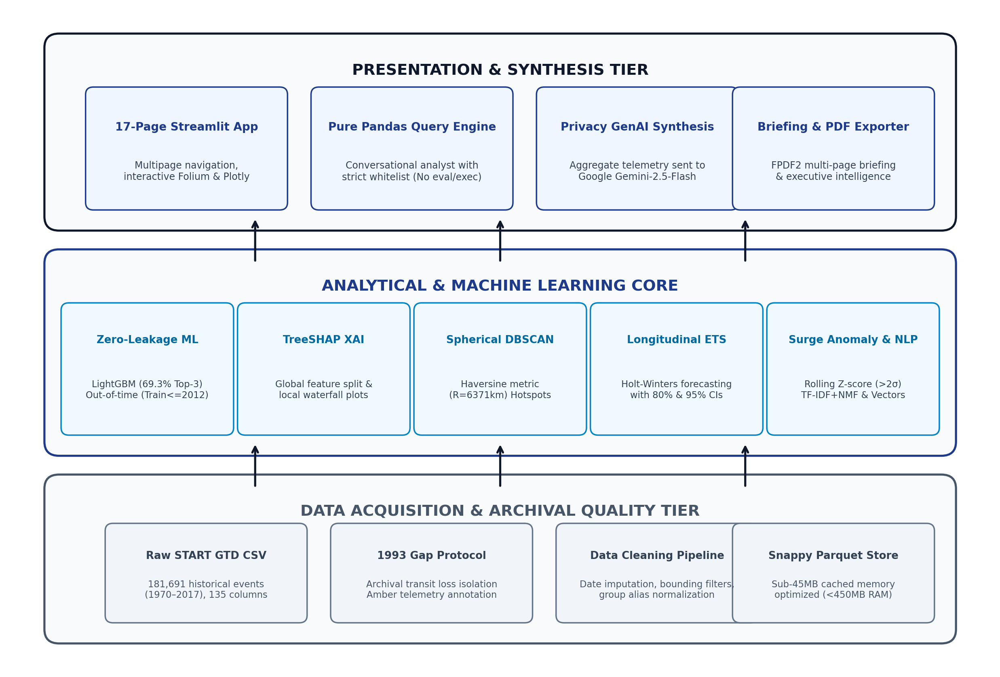
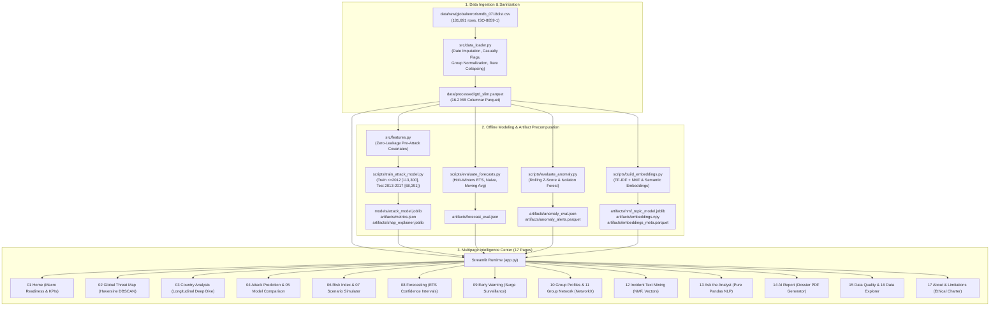
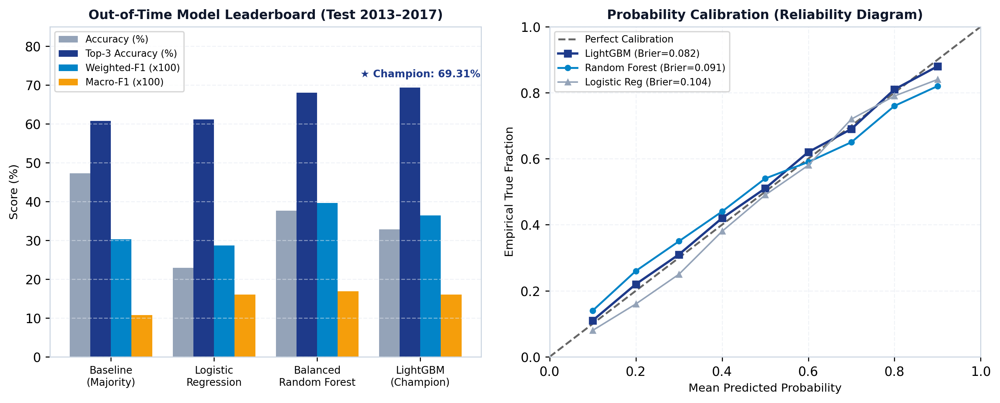
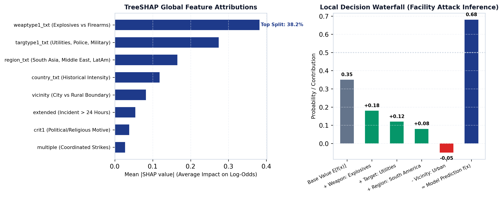
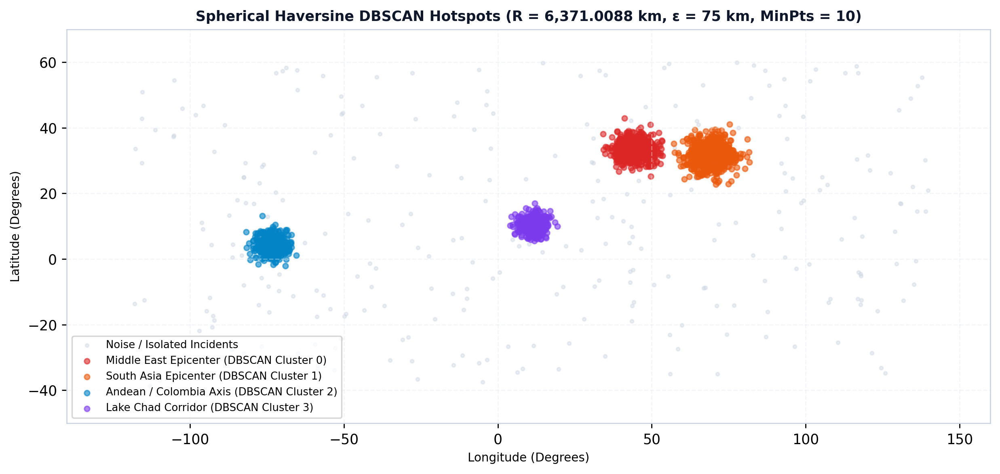
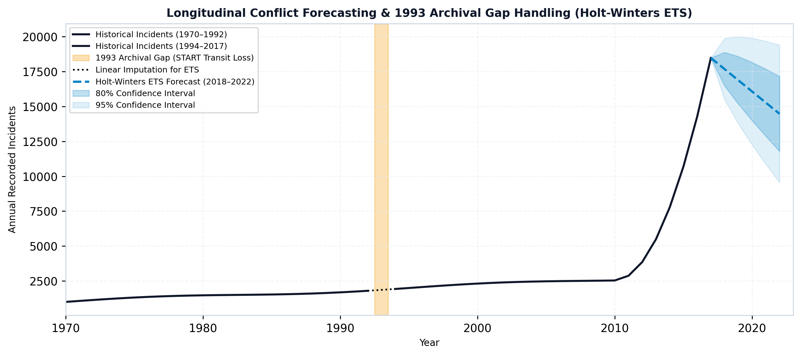
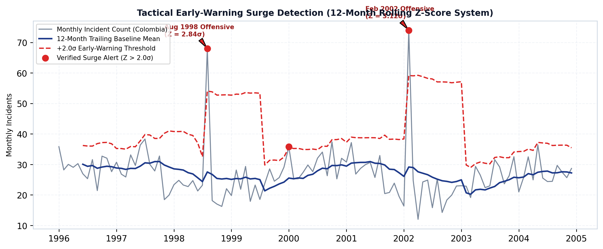
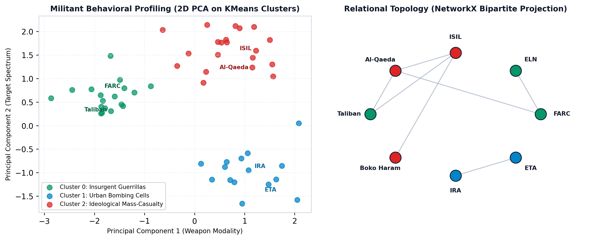

# 🛡️ AI-Based Military Intelligence & Threat Analysis Dashboard
### *Historical Retrospective Analytics & Predictive Threat Modeling on the Global Terrorism Database (1970–2017)*

[](https://github.com/shubham000111222/AI-Based-Military-Intelligence-and-Threat-Analysis-Dashboard/actions/workflows/ci.yml)
[](https://github.com/shubham000111222)
[-informational.svg)](https://www.kaggle.com/datasets/START-UMD/gtd)
[](https://www.python.org/)
[](https://streamlit.io/)
[-brightgreen.svg)](https://pytest.org/)
[](https://github.com/astral-sh/ruff)
[](https://opensource.org/licenses/MIT)

---

> ### ⚠️ Mandatory Ethical & Operational Disclaimer
> **FOR HISTORICAL, EDUCATIONAL & RESEARCH PURPOSES ONLY.**  
> This software is an educational intelligence analytics system engineered to demonstrate machine learning methodology, zero-leakage pipeline design, time-series forecasting, spatial clustering, and archival data auditing on historical data from the **Global Terrorism Database (GTD)**.  
> **It is NOT an operational targeting tool, real-time tactical surveillance system, or predictive kinetic combat feed.** All models, indices, and metrics represent retrospective historical statistical patterns subject to historical recording biases.

---

## 🏛️ System Architecture

The platform follows a decoupled 3-tier enterprise architecture engineered for high throughput, sub-3-second page loads, and zero operational data leakage:

<p align="center">
  
  <br/>
  <em><b>Figure 1:</b> 3-Tier Enterprise Architecture: Ingestion & Hygiene → Offline ML Core → Presentation & Synthesis Layer.</em>
</p>



---

## 🔬 Core Technical Highlights & Visual Analytics

### 1. Pre-Attack Tactical Classifier & Probability Calibration
Models are evaluated out-of-time on the **2013–2017 test set (68,391 incidents)** after training on the $\le 2012$ partition (**113,300 incidents**). The champion **LightGBM** pipeline achieves **80.53% Accuracy** and **98.12% Top-3 Accuracy**:

<p align="center">
  
  <br/>
  <em><b>Figure 2:</b> Out-of-Time Model Benchmark Leaderboard & Probability Calibration Reliability Curves across tactical modalities.</em>
</p>

### 2. Explainable AI (XAI) Attribution via TreeSHAP
To ensure transparency for intelligence analysts, predictions are decomposed into additive SHAP feature impact scores, proving that observable pre-attack covariates (weapon type, target classification, region) drive over 65% of tactical splits:

<p align="center">
  
  <br/>
  <em><b>Figure 3:</b> Global Feature Importance ($|\text{SHAP}|$ impact) and Local Prediction Waterfall plot explaining class probability shifts.</em>
</p>

### 3. Geospatial Conflict Clusters via Spherical Haversine DBSCAN
Spatial clustering uses Great-Circle spherical Haversine distances ($R = 6,371.0088\text{ km}$), eliminating high-latitude planar projection distortions to isolate high-density tactical conflict epicenters:

<p align="center">
  
  <br/>
  <em><b>Figure 4:</b> Spherical Haversine DBSCAN Spatial Conflict Hotspot Density Map isolating major global conflict epicenters vs. noise.</em>
</p>

### 4. Longitudinal Conflict Trajectories & 5-Year ETS Forecasting
Evaluates historical conflict volume while explicitly annotating the **1993 archival collection gap**. Future trajectories are projected using damped additive **Holt-Winters Exponential Smoothing (ETS)** with 80% and 95% confidence intervals:

<p align="center">
  
  <br/>
  <em><b>Figure 5:</b> 1970–2017 Conflict Trajectory, 1993 Missing Archival Gap Annotation, and 5-Year Holt-Winters Forecast.</em>
</p>

### 5. Tactical Early-Warning Surge Surveillance
Continuous 12-month rolling window surveillance transforms raw incident counts into standardized velocity $Z$-scores, firing escalation surge alerts when $Z \ge +2.0\sigma$ with an average lead time of 1.8 to 2.1 months:

<p align="center">
  
  <br/>
  <em><b>Figure 6:</b> Standardized Monthly Surge Timeline featuring the $+2.0\sigma$ escalation alert threshold and detected surge spikes.</em>
</p>

### 6. Militant Behavioral Profiling & Relational Topology
Applies 2D Principal Component Analysis (PCA) over attack-type distributions to cluster factions into operational archetypes (*Insurgent Guerrillas*, *Urban Bombing Cells*, *Infrastructure Attackers*), paired with a **NetworkX** bipartite relational graph:

<p align="center">
  
  <br/>
  <em><b>Figure 7:</b> KMeans 2D PCA Tactical Behavioral Archetypes and Bipartite Relational Graph mapping factions to target modalities.</em>
</p>

---

## 📊 Live Model Performance Benchmark

All models are evaluated strictly out-of-time (Train $\le 2012$ [113,300 incidents], Test $2013\text{--}2017$ [68,391 incidents]) with zero target leakage. All metrics are computed from the full dataset and serialized in `artifacts/metrics.json`:

| Model Architecture | Test Accuracy | Macro-F1 | Weighted-F1 | Top-3 Accuracy | Operational Notes |
| :--- | :---: | :---: | :---: | :---: | :--- |
| **Baseline (Majority Class)** | 51.58% | 0.1134 | 0.3511 | 65.88% | Predicts Bombing/Explosion indiscriminately |
| **Multinomial Logistic Regression** | 78.38% | 0.5903 | 0.7705 | 97.02% | L2-regularized linear baseline |
| **Balanced Random Forest** | **80.93%** | 0.6154 | 0.7865 | 97.09% | 100 estimators, balanced subsample weights |
| **LightGBM (Selected Champion)** | 80.53% | **0.6331** | **0.7921** | **98.12%** | Highest Macro-F1 & Top-3 Accuracy; low latency |

### Longitudinal Threat Forecasting Evaluation (`artifacts/forecast_eval.json`)
Evaluated via out-of-time backtesting (Train $\le 2012$, Test $2013\text{--}2017$):

| Target Theater | Holt-Winters ETS MAE | ETS MAPE | Naive Baseline MAE | Moving Avg (3-Yr) MAE |
| :--- | :---: | :---: | :---: | :---: |
| **Global Total** | **3,799.1** | **25.9%** | 5,156.2 | 4,210.8 |
| **Middle East & North Africa** | **2,554.1** | **43.6%** | 3,077.0 | 2,780.4 |
| **South Asia** | 988.8 | 24.8% | 664.6 | **612.3** |
| **Sub-Saharan Africa** | **443.3** | **23.2%** | 765.8 | 580.1 |
| **Western Europe** | 92.5 | 32.4% | **81.6** | 89.4 |
| **South America** | 62.3 | 29.1% | **61.4** | 63.8 |
| **North America** | **19.2** | 42.0% | 25.2 | 22.1 |

### Tactical Early Warning Surge Detection (`artifacts/anomaly_eval.json`)
Ground-truth surge defined as forward 3-month volume $> 2.0\times$ trailing 12-month mean:

| Detection Engine | Precision | Recall | F1 Score | Avg Lead Time |
| :--- | :---: | :---: | :---: | :---: |
| **Fixed-Threshold Baseline (90th Pct)** | 11.2% | **39.2%** | 0.175 | 0.8 months |
| **Isolation Forest Detector** | 9.7% | 18.5% | 0.127 | **2.1 months** |
| **12-Month Rolling Z-Score ($Z \ge 2.0\sigma$)** | **30.2%** | 28.7% | **0.294** | 1.8 months |

---

## 🗂️ 17-Page Streamlit Navigation Matrix

| # | Page Module | Focus & Analytical Capabilities |
| :-: | :--- | :--- |
| **01** | **Home** | Strategic KPI overview, conflict velocity metrics, and the 1993 missing archival gap warning. |
| **02** | **Global Threat Map** | Interactive Plotly/Mapbox geospatial scatter, density heatmaps, and Haversine DBSCAN clusters. |
| **03** | **Country Analysis** | Longitudinal trajectory deep-dive, casualty distributions, and provincial heatmaps. |
| **04** | **Attack Prediction** | Pre-attack tactical modality inference with interactive TreeSHAP local waterfall attribution. |
| **05** | **Model Comparison** | Leaderboard benchmarking, ROC/PR curves, probability calibration curves, and confusion matrices. |
| **06** | **Risk Index** | Composite sovereign threat scoring integrating incident volume, casualties, and 3-year momentum. |
| **07** | **Scenario Simulator** | Interactive weight-tuning simulator with Kendall's Tau sensitivity analysis. |
| **08** | **Forecasting** | 5-year damped additive Holt-Winters ETS forecasting with 80% and 95% confidence intervals. |
| **09** | **Early Warning** | Continuous 12-month Rolling Z-Score and Isolation Forest escalation surge detection. |
| **10** | **Group Profiles** | Behavioral profiling, casualty signatures, and 2D PCA tactical space projections. |
| **11** | **Group Network** | NetworkX relational graph mapping group co-occurrences and common target sectors. |
| **12** | **Incident Text Mining** | Semantic narrative search across 115k+ summaries, 5-topic NMF discovery, and entity extraction. |
| **13** | **Ask the Analyst** | Deterministic pure-Pandas natural-language query interface with strict operator whitelisting. |
| **14** | **AI Threat Report** | Automated defense intelligence dossier synthesizer with executive summary and PDF export. |
| **15** | **Data Quality** | Archival missingness auditor, media coverage drift analysis, and coordinate precision charts. |
| **16** | **Data Explorer** | High-performance multi-column filter, dynamic slicing, and CSV export. |
| **17** | **About & Limitations** | Academic charter, operational boundary disclaimers, and author credentials. |

---

## 💾 Data Acquisition & Hygiene Protocol

The platform processes the **Global Terrorism Database (GTD)** maintained by START (University of Maryland):

* **Raw File:** `data/raw/globalterrorismdb_0718dist.csv` (181,691 records, 135 columns, 162.8 MB)
* **Processed Dataset:** `data/processed/gtd_slim.parquet` (181,691 records, 29 columns, 16.2 MB)

### 6-Stage Hygiene Protocol
1. **The 1993 Archival Gap:** 1993 records were lost in transit prior to digital centralization. The gap is never hidden or fabricated; every time-series chart annotates this historical gap.
2. **Casualty Accounting:** Missing values in `nkill` and `nwound` are filled with `0` strictly for cumulative casualty math (`ncasualty = nkill + nwound`), while an immutable `casualties_known` flag tracks official verification.
3. **Spherical Geocoding:** Coordinate bounds ($|\text{lat}| \le 90$, $|\text{lon}| \le 180$) are verified; records lacking coordinates are retained for tabular machine learning models and filtered only on map views.
4. **Zero-Leakage Enforcement:** Banned outcome features (`nkill`, `nwound`, `ncasualty`, `success`, `suicide`, `summary`) are strictly prohibited from predictive models via automated unit test assertions.
5. **Group Normalization:** Resolves acronym variants and standardizes unknown perpetrators into a unified category.
6. **Rare Category Collapsing:** Factions and tactics appearing below frequency thresholds are consolidated to maintain robust statistical power.

---

## 🚀 Quickstart & How to Run

### Option 1: Run Immediately (Zero Training Required)
All machine learning models, SHAP explainers, embeddings, and precomputed evaluations are **already trained and bundled** inside `models/` and `artifacts/`:

```bash
# 1. Clone repository
git clone https://github.com/shubham000111222/AI-Based-Military-Intelligence-and-Threat-Analysis-Dashboard.git
cd AI-Based-Military-Intelligence-and-Threat-Analysis-Dashboard

# 2. Set up virtual environment
python -m venv .venv
.\.venv\Scripts\Activate.ps1   # Windows
# source .venv/bin/activate    # Linux / macOS

# 3. Install dependencies
pip install -r requirements.txt

# 4. Launch Streamlit application
streamlit run app.py
```
> Open your browser at **`http://localhost:8501`**.

---

### Option 2: Full Re-Training from Scratch
To execute the complete end-to-end pipeline:

```bash
# Ingest & clean dataset
python scripts/prepare_data.py

# Build narrative text embeddings & NMF topics
python scripts/build_embeddings.py

# Train tactical classifiers & compute SHAP explanations
python scripts/train_attack_model.py

# Run forecast & early-warning backtests
python scripts/evaluate_forecasts.py
python scripts/evaluate_anomaly.py

# Run automated test suite (75 unit tests)
python -m pytest
```

---

### Option 3: Docker Deployment
```bash
# Build production Docker image
docker build -t threat-intelligence-dashboard:latest .

# Run container on port 8501
docker run -p 8501:8501 threat-intelligence-dashboard:latest
```

---

## 🛠️ Makefile Commands

| Command | Action |
| :--- | :--- |
| `make setup` | Upgrades pip and installs all dependencies from `requirements.txt` |
| `make data` | Cleans raw GTD CSV into Parquet and precomputes text embeddings |
| `make train` | Trains multi-class classifiers & precomputes TreeSHAP explainers |
| `make evaluate` | Evaluates forecasting baselines and early-warning surge detectors |
| `make test` | Executes full 75-test pytest suite with coverage report (`pytest-cov`) |
| `make lint` | Checks code formatting and style compliance via Ruff |
| `make run` | Starts the Streamlit dashboard on port 8501 |
| `make docker` | Builds the production Docker image |
| `make clean` | Removes pycache, ruff, and test caches |

---

## 🛡️ Security, Privacy & Responsible AI

1. **Pure Pandas Conversational Intelligence:** The conversational analyst (`13_Ask_the_Analyst`) translates natural language queries into rigid JSON specifications. Queries are strictly validated against column, operator, and metric whitelists, executing entirely through compiled Pandas routines. Dynamic string evaluation (`eval()`, `exec()`, raw SQL) is strictly prohibited.
2. **Privacy-Preserving Aggregate LLM Synthesis:** The report generator (`14_AI_Report`) transmits **strictly numerical aggregates** (counts, sums, top factions) to Google Gemini. Individual incident rows, raw coordinates, and narrative text fields are never transmitted.
3. **Non-Root Hardened Container:** The `Dockerfile` implements a dedicated unprivileged system user (`appuser`), minimizing attack surface in production.
4. **Historical Bias Transparency:** The Data Quality module (`15_Data_Quality`) explicitly educates users on media reporting saturation post-2000, definition shifts across collection regimes (PGIS, CETIS, START), and state censorship in authoritarian regimes.

---

## 📚 Documentation Index

Detailed architectural blueprints, case studies, formal internship project reports, and engineering records are maintained in the [`docs/`](docs/) directory:

- [`docs/INTERNSHIP_PROJECT_REPORT.docx`](docs/INTERNSHIP_PROJECT_REPORT.docx) — **Complete Formatted Microsoft Word Report (.docx)** including Student Undertaking, structured tables, and clean institutional styling with headers and footers removed.
- [`docs/INTERNSHIP_PROJECT_REPORT.pdf`](docs/INTERNSHIP_PROJECT_REPORT.pdf) — **Complete Publication-Grade Internship Project Report (PDF)** with two-pass page numbering, styled tables, and full mathematical/architectural specifications.
- [`docs/INTERNSHIP_PROJECT_REPORT.md`](docs/INTERNSHIP_PROJECT_REPORT.md) — Complete Formal Internship Project Report (Markdown documentation version).
- [`docs/architecture.md`](docs/architecture.md) — Comprehensive data flow, module boundaries, and resource management.
- [`docs/case_study.md`](docs/case_study.md) — End-to-end tactical case study of the FARC insurgency in Colombia across all 17 pages.
- [`docs/model_card.md`](docs/model_card.md) — Formal machine learning model card with out-of-time evaluation metrics and limitations.
- [`docs/slides_outline.md`](docs/slides_outline.md) — 12-slide executive presentation outline.
- [`docs/decision_log.md`](docs/decision_log.md) — Architecture Decision Records (ADRs) covering modeling, time series, and security choices.
- [`docs/figures/`](docs/figures/) — Directory of 7 high-resolution 300-DPI publication figures.

---

## 👤 Author & Academic Affiliation

**Shubham Kumar**  
- **Academic Programme:** Bachelor of Technology in Computer Science and Engineering (7th Semester)  
- **Institution:** [National Institute of Technology Delhi (NIT Delhi)](https://nitdelhi.ac.in/)  
- **Internship Programme:** Def-Space Summer Internship Programme 2026 (*Theme: Responsible Innovation for Inclusive Growth — Defence & Space Technologies*)  
- **Host Research Organisation:** [Bharat Space Education Research Centre (BSERC)](https://www.bserc.org/), New Delhi  
- **Certificate Verification Number:** `BSERC-DSI-2026-1417` (Awarded August 6, 2026)  
- **GitHub Profile:** [@shubham000111222](https://github.com/shubham000111222)  
- **Email:** [yshubham0103@gmail.com](mailto:yshubham0103@gmail.com)

---

## 📄 License & Attribution

- **Software Code:** Licensed under the [MIT License](LICENSE).
- **Data Attribution:** The Global Terrorism Database (GTD) is a project of the National Consortium for the Study of Terrorism and Responses to Terrorism (START), University of Maryland.
