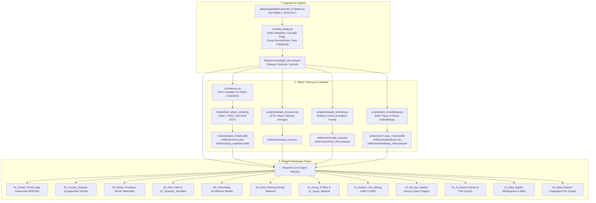

# System Architecture & Technical Specifications

## 1. System Overview

The **AI-Based Military Intelligence and Threat Analysis Dashboard** is a retrospective, educational intelligence analytics platform engineered for historical pattern discovery, risk indexing, predictive classification, and longitudinal forecasting on the Global Terrorism Database (GTD, 1970–2017).

The system enforces strict architectural boundaries:
- **Zero Kinetic / Real-Time Surveillance Targeting**: Explicitly architected as an academic and historical research tool.
- **Zero Target Leakage**: Predictive models strictly ingest pre-attack indicators and assert the absence of post-attack outcome variables (`nkill`, `nwound`, `success`, `suicide`, `summary`).
- **Strict Temporal Splitting**: All machine learning models, time-series forecasters, and anomaly detectors are evaluated out-of-time (Train $\le 2012$, Test $2013\text{--}2017$).
- **Resource Optimization**: Designed to operate within a 1 GB memory envelope (Streamlit Community Cloud) via offline artifact precomputation and columnar Parquet caching.

---

## 2. End-to-End Data Pipeline Architecture

---

## 3. Module Boundaries & Responsibilities

| Module | Core Responsibility | Key Functions / Classes |
| :--- | :--- | :--- |
| `src.config` | Centralizes file paths, schema definitions, model cutoff years, visual themes, and ethical disclaimers. | `KEEP_COLUMNS`, `BANNED_LEAKAGE_COLUMNS`, `TRAIN_MAX_YEAR`, `THEME_COLORS` |
| `src.data_loader` | Ingestion, date imputation (`imonth=0, iday=0`), casualty imputation with flags, coordinate bounds filtering, and group normalization. | `load_dataset()`, `clean_data()`, `normalise_group_names()` |
| `src.data_quality` | Telemetry on column missingness by decade, unknown perpetrator share, coordinate precision, annual quality scoring, and reporting bias context. | `compute_missingness_by_column()`, `compute_annual_data_quality_scores()` |
| `src.features` | Zero-leakage pre-attack feature extraction, strict leakage assertion checks, and temporal train/test splitting. | `extract_pre_attack_features()`, `assert_no_leakage()`, `split_by_time()` |
| `src.hotspots` | Spherical DBSCAN spatial clustering using haversine metric on radian coordinates ($R = 6371.0088\text{ km}$). | `compute_spatial_clusters()`, `filter_valid_coordinates()` |
| `src.models` | Multi-class attack type modeling (Baseline, Logistic Regression, Random Forest, LightGBM), calibration curves, and regional Macro-F1. | `evaluate_model()`, `compute_calibration_curves()`, `compute_top_k_accuracy()` |
| `src.risk_index` | Country-year composite risk index from normalized log-incidents, log-casualties, 3-year momentum slope, and mass-casualty ratio. | `compute_risk_index()`, `evaluate_ranking_stability()` |
| `src.forecasting` | Longitudinal annual threat forecasting using Holt-Winters Exponential Smoothing (ETS) with 80%/95% confidence intervals and 1993 interpolation. | `fit_exponential_smoothing()`, `evaluate_forecast_backtest()` |
| `src.anomaly` | Monthly tactical surge detection for top-50 countries via 12-month Rolling Z-Scores and Isolation Forests. | `fit_and_detect_anomalies()`, `evaluate_early_warning_backtest()` |
| `src.groups` | Behavioral feature vector extraction for factions with $\ge 20$ incidents, KMeans clustering with heuristic archetypes, and PCA projection. | `extract_group_behavior_vectors()`, `cluster_and_project_groups()` |
| `src.network` | NetworkX relational graphs across shared target profiles, geographic footprints, and co-claims with greedy modularity community detection. | `build_group_network()` |
| `src.text_mining` | Unsupervised TF-IDF + NMF topic modeling (5 tactical themes), named entity recognition (GPE, ORG, PERSON), and dense semantic similarity search. | `fit_nmf_topics()`, `extract_named_entities()`, `search_similar_incidents()` |
| `src.query_engine` | Natural language to structured JSON query specs, security whitelist validation, and pure pandas execution (strictly zero `eval`/`exec`). | `ask_analyst()`, `validate_query_spec()`, `execute_query_spec()` |
| `src.report` | Privacy-preserving aggregate threat statistics compiling and executive brief generation via Gemini (`google-genai`) with deterministic offline fallback. | `build_threat_stats_summary()`, `generate_gemini_report()` |
| `src.pdf_export` | Executive PDF document generation using `fpdf2`, featuring classified-style banners, telemetry summaries, and sanitized typography. | `generate_pdf_report()` |

---

## 4. Technical Stack & Architectural Tradeoffs

### 4.1 Machine Learning & Statistical Modeling
- **LightGBM & Random Forest**: Chosen for tabular data efficiency, fast inference, native multi-class support, and class-weight balancing over computationally expensive deep neural networks.
- **Holt-Winters ETS**: Selected over complex deep auto-regressive networks (e.g. DeepAR, Temporal Fusion Transformers) due to superior stability and interpretability on sparse, annual historical time series with known structural shocks.
- **Spherical Haversine DBSCAN**: Preferred over Euclidean clustering to account for Earth's ellipsoidal curvature and avoid severe spatial distortion in equatorial vs. high-latitude theatres.

### 4.2 Application Architecture & Memory Management
- **Streamlit Multipage Architecture**: Provides rapid interactive exploratory capabilities.
- **Sub-1 GB Memory Footprint**: 
  - Raw 160MB CSV is compiled into an optimized Snappy Parquet file (`data/processed/gtd_slim.parquet`), loaded with `st.cache_data`.
  - Heavy model training, SHAP calculations, embedding generations, and backtests are executed **offline** and serialized into `artifacts/`.
  - At runtime, the dashboard simply reads lightweight serialized JSONs, Parquets, and NumPy matrices, ensuring instant UI rendering with sub-second latency.

---

## 5. Security & Privacy Safeguards

1. **Pure Pandas Execution**: The conversational query engine (`src/query_engine.py`) strictly validates user questions against an approved column and operator whitelist. Dynamic code evaluation (`eval()`, `exec()`, raw SQL) is prohibited.
2. **Privacy-Preserving LLM Synthesis**: The report generation pipeline transmits **only** high-level numerical aggregates (total counts, top 5 factions, yearly trends) to Google Gemini. Individual incident rows, raw coordinates, and narrative text are never transmitted.
3. **Non-Root Container Hardening**: The production `Dockerfile` runs under a dedicated, unprivileged system user (`appuser`), minimizing attack surface in containerized environments.
